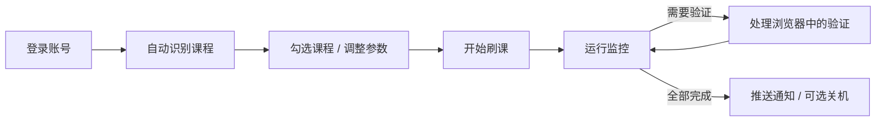
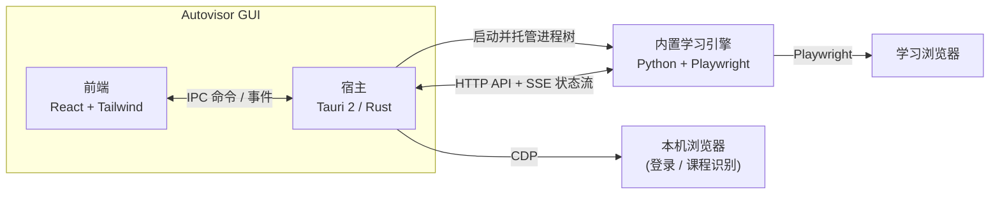

<div align="center">


# Autovisor GUI

**知到 · 智慧树自动化学习助手**

一个开箱即用的桌面客户端：登录账号 → 自动识别课程 → 一键开始，学习进度、日志与提醒全部可视化。

[](https://github.com/RRRRUDDDD/Autovisor-GUI/releases)
[](https://tauri.app)
[](https://react.dev)
[](https://www.rust-lang.org)
[](pyproject.toml)
[](LICENSE)

[下载](https://github.com/RRRRUDDDD/Autovisor-GUI/releases) · [使用指南](#使用指南) · [本地开发](#本地开发) · [常见问题](#常见问题) · [反馈](https://github.com/RRRRUDDDD/Autovisor-GUI/issues)

</div>

---

## 目录

- [功能概览](#功能概览)
- [下载与安装](#下载与安装)
- [使用指南](#使用指南)
- [学习参数](#学习参数)
- [大模型智能答题](#大模型智能答题)
- [消息推送](#消息推送)
- [数据与隐私](#数据与隐私)
- [技术架构](#技术架构)
- [本地开发](#本地开发)
- [命令行模式](#命令行模式)
- [常见问题](#常见问题)
- [致谢](#致谢)
- [许可证与声明](#许可证与声明)

## 功能概览

应用由四个主要页面组成：

| 页面 | 能做什么 |
| --- | --- |
| **登录** | 手机号 / 学号（支持高校库检索）/ 应用内扫码登录；已保存凭证自动恢复登录（三态校验，网络波动不误判掉线）；登录前可配置网络代理 |
| **自动学习** | 登录后优先通过接口直拉账号下全部在学课程；搜索、勾选、排序课程队列；多行批量粘贴课程 / 作业 / 考试链接精准路由；配置倍速、时长、复习模式等参数后一键开始 |
| **运行监控** | 实时显示当前课程 / 课时、播放进度、运行耗时、已完成课时；需人工处理时醒目提示；执行日志支持级别筛选、搜索、复制（写入与复制均自动脱敏） |
| **系统设置** | 大模型答题、答题增强与题库缓存（导出 / 导入 / 清理）、消息推送、浏览器与代理、Cookie 与自动重登凭证、历史日志与轮转归档、完成后关机、窗口关闭行为、版本更新、引擎重启 |

**支持的课程与任务类型：** 智慧共享课（视频完成后自动扫描并完成作业与进行中考试）· 翻转课（视频 + 非视频文档标记已读）· 融合共享课 · AI 慕课（wisdom-mooc）· AI 智慧课（视频 + 非视频文档资源 + 知识点掌握度 + 综合考试）· 直接粘贴知到作业（`doHomework`）/ 知到考试（`doExam`）/ AI 测试详情（`testDetail`）链接

**其他特性：**

- 🔍 自动识别本机 Edge / Chrome / Brave / Vivaldi / 360 / QQ 浏览器 / Chromium，无需手动配置路径
- ⚡ 基于 CAS SSO 与加密接口直拉全量课程并隔离多域名 Cookie，兼顾速度与登录态稳定
- 🧩 自动处理易盾 / 腾讯滑块与点选验证（配置视觉模型后自动支持易盾文字 / 图标点选），作业与考试触发 `-12` 风控时自动纯 HTTP 易盾过码重试；遇到无法自动处理的安全验证时将浏览器前置并推送提醒
- 🙈 隐藏浏览器窗口后台学习，不影响日常使用电脑
- 🎯 课中弹题支持只读接口拦截，优先直接读取服务端答案，未命中再回退平台 AI 或自定义大模型
- 📝 知到作业与正式考试优先走加密 API 明文作答（图片题自动检测并回退视觉模型），作业支持达标得分率判定与错题自动重做闭环；AI 智慧课自动提取知识点 PPT 文本作为答题参考
- 🤖 可选接入大模型辅助答题，兼容 OpenAI / Claude / Gemini / Azure / Ollama 及国内主流模型，支持视觉模型自动作答图片题、识别易盾点选验证及流式双超时控制
- 🗂️ 内置本地 SQLite 题库缓存（支持导入 / 导出 / 一键清理），可选接入第三方题库接口作参考（默认关闭，支持按任务类型配置生效范围，默认仅考试启用）
- 🪵 日志支持单文件体积轮转、保留天数与数量上限清理、超期 gzip 压缩归档及敏感字段自动脱敏
- 🔔 Windows 系统通知 / Server 酱 / Qmsg 酱 / Bark / Telegram 推送
- ⏻ 任务完成后可自动关机（60 秒倒计时，可随时取消）
- 🌗 浅色 / 深色主题，响应式布局（窄屏自动切换为底部导航）
- 🪟 单实例运行，可最小化到系统托盘
- ⬆️ 自动检查 GitHub 新版本并提示下载

## 下载与安装

### 系统要求

- **操作系统**：Windows 10 / 11（x64）、macOS 12+（Apple Silicon `arm64` / Intel `x64`）、Linux（x64，如 Ubuntu 22.04+ / Debian 12+）
- **浏览器**：本机已安装任意 Chromium 内核浏览器（推荐 Chrome 或 Edge）
- **WebView 运行时**：Windows 11 / macOS 自带；Windows 安装版缺失 WebView2 时会自动静默安装；Linux 需系统包含 `libwebkit2gtk-4.1`

### 获取程序

前往 [Releases](https://github.com/RRRRUDDDD/Autovisor-GUI/releases) 下载对应系统的发行包：

| 平台 | 发行形式 | 文件 | 说明 |
| --- | --- | --- | --- |
| **Windows (x64)** | 安装版（推荐） | `Autovisor-GUI-Setup-<版本>-windows-x64.exe` | 标准安装向导，创建开始菜单快捷方式，可正常卸载 |
| **Windows (x64)** | 便携版 | `Autovisor-GUI-<版本>-windows-amd64.zip` | 解压后双击 `Autovisor GUI.exe` 即用，所有数据保存在程序目录中，适合 U 盘携带 |
| **macOS (Apple Silicon)** | DMG 镜像 | `Autovisor-GUI-<版本>-macos-arm64.dmg` | 适用于 M1 / M2 / M3 / M4 芯片 Mac，打开后将 `Autovisor GUI.app` 拖入 `Applications` |
| **macOS (Intel)** | DMG 镜像 | `Autovisor-GUI-<版本>-macos-x64.dmg` | 适用于 Intel 芯片 Mac，打开后将 `Autovisor GUI.app` 拖入 `Applications` |
| **Linux (x64)** | DEB 安装包 | `Autovisor-GUI-<版本>-linux-amd64.deb` | 适用于 Ubuntu / Debian 系发行版（`sudo apt install ./Autovisor-GUI-<版本>-linux-amd64.deb`） |
| **Linux (x64)** | 便携版 | `Autovisor-GUI-<版本>-linux-amd64.tar.gz` | 解压后运行 `./autovisor-gui` 即用，数据保存在程序目录 `userdata/` 下 |

### 数据目录

| 平台 / 发行形式 | 配置、Cookie、日志的存放位置 |
| --- | --- |
| Windows 安装版 | `%APPDATA%\com.autovisor.gui\userdata\` |
| macOS 应用版 | `~/Library/Application Support/com.autovisor.gui/userdata/` |
| Linux 安装版（`.deb`） | `~/.config/com.autovisor.gui/userdata/` |
| 便携版（Windows / Linux） | 程序目录下的 `userdata/` |

可在「系统设置 → 运行环境与版本」中一键打开数据目录。

## 使用指南



**1. 登录**

启动后选择登录方式：

- **手机号登录**：输入绑定手机号与密码；
- **学号登录**：输入学校名称关键字检索并选择学校，再输入学号与密码；
- **扫码登录**：应用内直接显示二维码，用知到 App 扫码确认即可（也可保存二维码图片，或改用浏览器扫码）。

勾选「记住账号密码」后，挂机中途登录失效时会自动重新登录。下次启动若本地凭证仍有效，会自动跳过登录。

**2. 选择课程**

登录成功后，程序会自动拉取你的在学课程并填入课程队列（默认全不选，按需勾选避免误刷）。你可以：

- 勾选 / 取消要学习的课程，调整学习顺序；
- 点击「刷新课程」重新同步；
- 在「手动补充链接」中粘贴课程播放页地址（支持多行批量粘贴，自动去重）；
- 对单门课程执行「只读检测」，确认目录能否被正确识别。

**3. 开始学习**

在右侧调整 [学习参数](#学习参数)，点击 **开始刷课**（复习模式下为 **开始复习刷分**）。配置修改会自动保存。

**4. 运行监控**

任务启动后自动进入监控页，可随时停止任务。当页面提示「需要留意浏览器窗口」时，请在弹出的浏览器中完成验证，程序会自动继续。

> [!TIP]
> 关闭主窗口时可选择 **最小化 / 最小化到托盘 / 直接退出**，并可勾选「记住我的选择」；之后可在「系统设置 → 桌面窗口」中修改。退出程序时会自动保存 Cookie 并关闭学习浏览器。

## 学习参数

| 参数 | 说明 |
| --- | --- |
| 播放倍速 | 视频播放速度，最高 1.8x |
| 单门课程时长限制 | 每门课最多学习多少分钟，`0` 为不限制 |
| 复习模式（刷习惯分） | 忽略已完成状态重播视频；设置时长后循环播放直至满足时长 |
| 自动跳过验证码 | 自动处理登录与课中滑块 / 点选验证（配置视觉模型后支持易盾文字 / 图标点选），并在作业与考试触发 `-12` 风控时自动纯 HTTP 过码重试 |
| 静音播放 | 视频静音，避免后台挂机出声 |
| 隐藏浏览器窗口 | 把浏览器移出屏幕后台学习，遇到安全验证时自动前置 |
| 课中弹题接口拦截 | 只读监听播放页官方 AI 弹题响应，直接取服务端正确答案，未命中时静默回退（默认开启） |
| 课中弹题优先用智慧树 AI | 弹题未命中拦截时先尝试平台自带 AI 作答，失败后回退到你配置的大模型 |
| 知到作业优先走加密 API | 命中作业页或共享课视频完成后优先通过加密接口明文作答，图片题自动回退视觉模型（默认开启） |
| 作业达标得分率 / 错题重做轮数 | 作业得分率低于目标（默认 100%）时自动重做错题，最多重做指定轮数（默认 3 轮） |
| 接管知到正式考试接口 | 命中知到正式考试时通过加密接口作答（默认开启；是否自动交卷受大模型设置中的「测验 / 作业自动提交」控制） |
| AI 智慧课自动刷掌握度 | 视频完成后继续完成知识点掌握度题目与综合考试 |
| AI 智慧课跳过免考知识点考核 | 仅在掌握度与接口考核阶段跳过免考知识点，不影响必学视频与文档资源补齐（默认开启） |
| 接口版自动完成计分考试 | AI 智慧课视频完成后通过接口作答，成绩达标即跳过该知识点 |
| PPT 课件辅助答题 | 自动提取 AI 智慧课知识点 PPT 文本作为答题参考资料（默认开启） |
| 掌握度目标 | 掌握度目标百分比（1–100），同时作用于掌握度与接口版计分考试 |
| 复习 / 模拟考试接口作答 | 捕获新打开的复习、模拟考试页并作答（默认关闭，**正式考试请勿开启**） |
| 日志轮转与归档 | 可在设置中配置单份日志上限（MB）、保留天数、文件数上限及超期 gzip 压缩归档天数 |
| 完成后关机 | 任务正常完成后倒计时 60 秒关机；手动停止、出错或诊断任务不会关机 |

## 大模型智能答题

可选功能，在「系统设置 → 大模型智能答题」与「答题增强与题库」中配置。未配置时自动跳过，调用失败时自动回退为默认行为。

1. 选择 **模型服务商**（内置国内主流、国际主流、聚合平台、本地部署等多组预设，会自动填好地址与协议）；
2. 填写 **API Key**（本地 Ollama / LM Studio 可留空）；
3. 点击 **获取模型** 拉取模型列表，或手动输入模型名称；
4. 点击 **测试模型连接** 验证可用性；按需调整 **流式总超时**（默认 120s）与 **流式空闲超时**（默认 30s）。

支持的接口协议：

| 协议 | 适用范围 |
| --- | --- |
| OpenAI 兼容（Chat Completions） | DeepSeek、通义千问、智谱 GLM、Kimi、豆包、硅基流动、OpenRouter、各类 OneAPI / NewAPI 中转等 |
| OpenAI Responses API | OpenAI `/responses` 接口 |
| Anthropic | Claude 原生 `/v1/messages` |
| Google Gemini | Gemini 原生 `generateContent` |
| Azure OpenAI | 需填写部署名与 `api_version` |
| Ollama | 本地 `/api/chat` |

**图片题与易盾点选验证**：作业 / 考试的题干与选项常以图片渲染（或加密接口返回含图题目），登录与课中也可能出现易盾文字 / 图标点选验证。在「视觉模型（图片题）」中填写支持读图的模型 ID（如 `gpt-4o`、`Qwen/Qwen2.5-VL-72B-Instruct`、`glm-4v-plus`），会复用同一服务商的 API Key、地址与协议：程序会自动识别图片题并逐题截图作答，同时自动求解易盾文字 / 图标点选验证码；留空则跳过图片题并将点选验证交由人工处理。

**题库缓存与第三方题库**：

- **本地 SQLite 题库缓存**：已答题目与错题订正结果会自动缓存在本机 `questions_bank.db` 中并跨卷复用；可在「系统设置 → 答题增强与题库」中 **导出 / 导入 / 清理** 题库缓存；
- **可选第三方题库参考**：留空 Token 时完全关闭；填入 Token 与查询地址后可点击 **测试题库连通性**，答题时作为参考来源之一（查询会话与智慧树 Cookie 完全隔离，支持瞬时失败自动重试）。可在「外部题库生效范围」中按任务类型开关生效场景（默认仅在知到考试与 AI 考试启用，避免可重做的平时作业消耗付费题库次数）。

「测验 / 作业自动提交」关闭时，程序只填写并保存/暂存答案（同时作用于作业、测验与知到正式考试），方便你核对后手动提交。

## 消息推送

在「系统设置 → 消息推送通知」中选择渠道并点击 **测试推送** 验证：

| 渠道 | 需要填写 |
| --- | --- |
| Windows 系统通知 | 无 |
| Server 酱 | `https://sctapi.ftqq.com/<SendKey>.send` |
| Qmsg 酱 | `https://qmsg.zendee.cn/send/<key>` |
| Bark | `https://api.day.app/<key>/` |
| Telegram | `https://api.telegram.org/bot<token>/sendMessage` + Chat ID |

可分别开关三类提醒：**遇安全验证 / 需人工登录**、**任务异常中断**、**学习完成 / 达到时限**。

## 数据与隐私

- 所有数据（配置、Cookie、SQLite 题库缓存、日志）**仅保存在本机**数据目录，不上传任何服务器；
- 启用视觉模型后，作业/考试题目截图与易盾文字/图标点选验证码图片会发送给你在设置中配置的大模型服务商；不填写视觉模型则不会发送；
- 第三方题库默认关闭；仅在填写 Token 后向你配置的地址查询题目文本，请求会话与智慧树 Cookie 完全隔离；
- 登录密码**默认不保存**；勾选「记住账号密码」时通过系统凭据库加密保存（Windows DPAPI / macOS Keychain / Linux Secret Service，无密钥链环境降级为 `0o600` 权限受限文件），且不向前端 WebView 下发明文密码；如在设置中手动配置了挂机「自动重登凭证」，则保存在本机 `config.ini`，均可随时清除；
- 内置引擎只监听本地回环地址，启动时通过 `stdin` 握手传递随机鉴权令牌（Fail-Closed 鉴权并校验 `Host` / `Origin`）；
- 日志写入与复制时都会自动遮盖手机号、密码、Cookie、Bearer Token、API Key 等常见敏感字段，分享前仍建议自行检查；
- 网络代理同时作用于登录、课程拉取、浏览器学习、更新检查与推送通知。

## 技术架构



| 层 | 技术 | 职责 |
| --- | --- | --- |
| 前端 | React 18、Tailwind CSS、Vite、ESLint、Vitest | 界面、运行态存储隔离、配置模型、自动保存、题库缓存管理、日志展示 |
| 宿主 | Tauri 2、Rust | 窗口 / 托盘 / 单实例、浏览器自动检测、CDP 登录、凭据加密存储与配置读写、引擎生命周期 |
| 引擎 | Python、Playwright、OpenCV、SQLite | 课程直拉与解析、任务路由、课程播放与切换、验证码处理、作业/考试加密 API、弹题拦截、题库缓存、推送、日志轮转 |

- 宿主启动时在后台拉起引擎，通过 `stdin` 首行握手传递随机令牌并经 JSON 握手获取监听端口，再通过增量 SSE 状态流实时接收进度、日志和提醒；
- 通过 `stdin` 生命周期监听与 Windows Job Object 管理进程树，窗口关闭或任务停止时不会残留浏览器 / 引擎进程；
- 引擎异常退出时可在界面中一键重启。

### 目录结构

```text
.
├── gui/                        # 桌面客户端
│   ├── src/                    #   React 前端
│   │   ├── components/         #     登录 / 工作台 / 监控 / 设置及子组件
│   │   ├── hooks/              #     自动保存、SSE 状态流、更新检查等 Hooks
│   │   └── lib/                #     Tauri 调用封装、运行态存储、配置模型、大模型预设
│   ├── src-tauri/              #   Rust 宿主
│   │   └── src/                #     backend / commands / config / credentials / zhs / process_tree ...
│   ├── build-installer.ps1     #   构建 NSIS 安装包
│   └── build-portable.ps1      #   构建便携版
├── backend_server.py           # 内置学习引擎入口
├── build_backend.py            # 打包引擎为 autovisor-backend.exe
├── modules/                    # 引擎核心模块（课程解析、播放、路由、加密接口、作业/考试、题库缓存、验证码、日志……）
├── scripts/                    # PyInstaller 共享构建工具
├── Autovisor.py                # 命令行入口
├── docs/                       # 智慧树接口契约与跨端 IPC / 配置契约文档
├── resources/                  # 引擎脚本资源与三端共享大模型厂商目录
├── data/                       # 默认镜像源 / 大模型配置模板
└── tests/                      # Python 单元测试
```

## 本地开发

### 环境准备

| 工具 | 版本 |
| --- | --- |
| Python | 3.10 – 3.13，推荐配合 [uv](https://docs.astral.sh/uv/) |
| Node.js | 20+ |
| Rust | stable（含 Tauri 2 的 [系统依赖](https://tauri.app/start/prerequisites/)） |

### 启动开发环境

```powershell
# 1. 安装引擎依赖（会在仓库根目录创建 .venv）
uv sync

# 2. 安装前端依赖并启动 Tauri 开发模式
cd gui
npm install
npm run tauri dev
```

开发模式下，宿主会自动向上查找仓库中的 `backend_server.py`，并使用根目录 `.venv` 中的 Python 启动引擎，数据直接读写仓库根目录。

> [!NOTE]
> 只调试界面时可运行 `npm run dev`，在普通浏览器中打开；此时所有 Tauri 调用会回退到内置的演示数据。

### 运行测试与检查

```powershell
uv run --no-sync python backend_server.py --verify-deps    # 引擎依赖自检
uv run --no-sync python -m unittest discover -s tests -v   # 引擎单测
cd gui; npm run lint; npm test; npm run build              # 前端静态检查、单测与构建
cd src-tauri; cargo clippy --all-targets -- -D warnings; cargo test  # 宿主静态检查与单测
```

CI 会在 Windows、macOS、Ubuntu 上执行以上三端测试、Lint / Clippy 与构建检查。

### 打包发布

```powershell
cd gui

# 便携版 → dist/Autovisor-GUI-<版本>-windows-amd64/
powershell -ExecutionPolicy Bypass -File .\build-portable.ps1

# 安装版 → dist/Autovisor-GUI-Setup-<版本>-windows-x64.exe
powershell -ExecutionPolicy Bypass -File .\build-installer.ps1
```

两个脚本都会先构建内置引擎（`build_backend.py`），再构建前端与 Tauri Release；加 `-SkipBackendBuild` 可复用已构建的引擎。发布流水线会校验 `modules/version.py`（`__gui_version__`）、`gui/package.json`、`gui/src-tauri/Cargo.toml` 与 `gui/src-tauri/tauri.conf.json` 四处版本号保持一致。

> [!NOTE]
> GitHub Actions 发布流水线会自动并行构建 Windows（NSIS 安装包 + 便携版 `.zip`）、macOS（`arm64` / `x64` `.dmg`）与 Linux（`.deb` + 便携版 `.tar.gz`）三端发行包。

## 命令行模式

仓库保留了无界面的命令行入口，适合服务器或脚本场景：

```bash
cp config.ini.example config.ini   # 填写课程链接等配置
uv run python Autovisor.py --help
```

macOS / Linux 可分别参考 `config.macos.ini.example`（配合 `run_macos.sh`）与 `config.linux.ini.example`。

## 常见问题

<details>
<summary><b>界面提示「内置学习引擎异常」？</b></summary>

点击提示条右侧的「重试启动引擎」，或在「系统设置 → 运行环境与版本」中重启引擎。若反复失败，多为安全软件拦截了 `runtime/` 中的引擎程序，请将程序目录加入信任列表后重试。

</details>

<details>
<summary><b>提示未检测到浏览器？</b></summary>

在登录页或「系统设置 → 浏览器与网络」中点击「重新扫描」；仍未识别时，可手动选择浏览器的可执行文件（如 `msedge.exe`、`chrome.exe`）。

</details>

<details>
<summary><b>登录后没有识别到课程？</b></summary>

点击「刷新课程」重新同步；若课程确实存在但未出现，可通过「手动补充链接」粘贴课程**播放页**地址。

</details>

<details>
<summary><b>运行中提示「需要留意浏览器窗口」？</b></summary>

说明遇到了需要人工处理的安全验证或登录失效。浏览器窗口会自动前置，完成验证后程序会自动继续。开启推送后，你也会同时收到提醒。

</details>

<details>
<summary><b>课程卡住不动 / 不会切换下一课？</b></summary>

- 请勿最小化学习浏览器（会暂停页面渲染），需要后台学习请开启「隐藏浏览器窗口」；
- 可对该课程执行「只读检测」确认目录是否被识别；
- 仍有问题请在 issue 中附上课程类型与「历史运行日志」中的日志文件。

</details>

<details>
<summary><b>开启了完成后关机，想临时取消？</b></summary>

倒计时期间在运行监控页点击「取消关机」即可；也可以在命令提示符中运行 `shutdown /a`。

</details>

<details>
<summary><b>如何彻底重置？</b></summary>

在设置中清除 Cookie 与已保存账密，或直接删除 [数据目录](#数据目录) 后重新启动。

</details>

## 致谢

本项目的开发参考并受益于以下优秀的开源项目，在此表示衷心感谢：

- [CXRunfree/Autovisor](https://github.com/CXRunfree/Autovisor)：基于 Playwright 的智慧树自动化学习程序
- [VermiIIi0n/fuckZHS](https://github.com/VermiIIi0n/fuckZHS)：智慧树刷课脚本
- [pjm314159/zhs](https://github.com/pjm314159/zhs)：智慧树公开接口字段文档参考

## 许可证与声明

本项目基于 [MIT License](LICENSE) 开源。

本程序仅供学习和研究使用，请勿用于商业或非法用途。使用者应遵守所在学校及平台的相关规定，因使用本程序产生的一切后果由使用者自行承担。

如果这个项目对你有帮助，欢迎点个 Star ⭐
